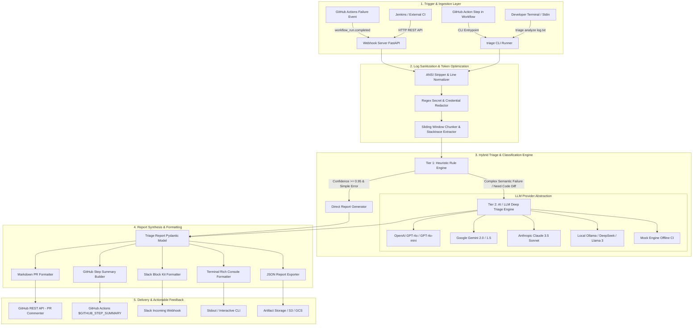
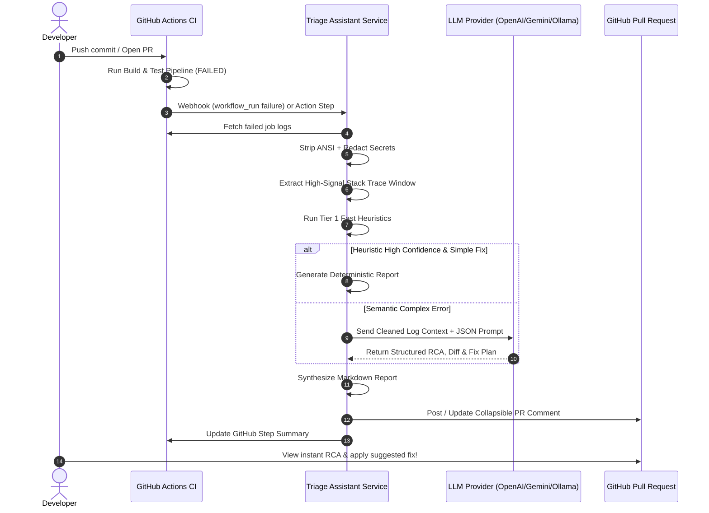
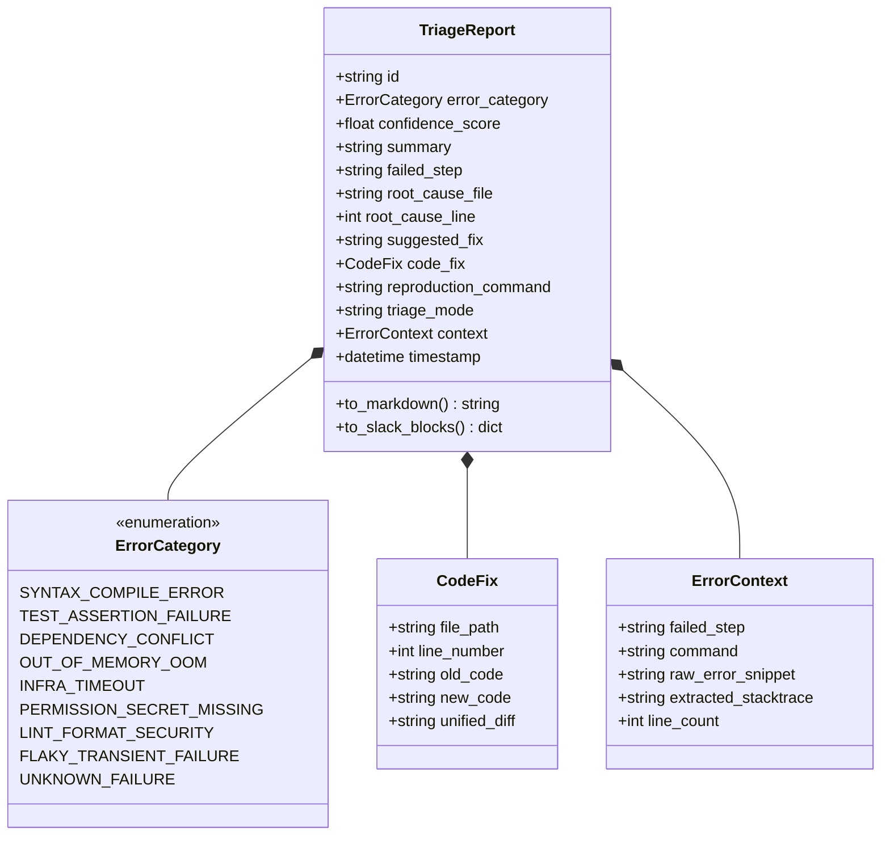

# System Architecture
## AI-Powered CI/CD Build Failure Triage Assistant

**Version:** 1.0.0  
**Architectural Style:** Modular Microservice & Portable CLI / GitHub Action  

---

## 1. High-Level Architecture Overview

The **AI-Powered CI/CD Build Failure Triage Assistant** is engineered with a modular, layered pipeline architecture. It decouples log ingestion, security sanitization, classification heuristics, AI/LLM inference, and notification delivery.

---

## 2. Core Architectural Components

### 2.1 Ingestion & Webhook Layer (`src/triage/integrations/`)
- **FastAPI Webhook Server (`webhook_server.py`)**:
  - Exposes `/webhook/github` endpoint verifying `X-Hub-Signature-256`.
  - Captures `workflow_run.completed` events with `conclusion == "failure"`.
  - Downloads workflow job logs using Octokit/PyGithub REST API.
- **CLI Runner (`cli.py`)**:
  - Standalone executable powered by `typer`/`click`.
  - Operates on local log files, pipes from stdin (`cat build.log | triage analyze`), or fetches logs directly via `--repo` and `--run-id`.

### 2.2 Sanitization & Reduction Subsystem (`src/triage/parser/`)
- **Sanitizer (`sanitizer.py`)**:
  - Regex-based ANSI escape code removal (`\x1b\[[0-9;]*[a-zA-Z]`).
  - Carriage return normalization and non-printable control character filtering.
- **Redactor (`redactor.py`)**:
  - Scans for high-entropy tokens and predefined regex signatures (AWS, GitHub, Slack, OpenAI, Bearer tokens, private keys).
  - Replaces matches with cryptographic placeholders (e.g. `[REDACTED_AWS_KEY]`) *before* logs enter memory buffers destined for LLMs.
- **Chunker & Stack Trace Extractor (`chunker.py`, `stacktrace_extractor.py`)**:
  - Employs **Reverse Tail Scanning**: Starts at EOF and walks backwards to identify the latest unhandled exception.
  - Multi-language regex library recognizing Python tracebacks, Java stack traces, NPM error tables, Go panic logs, Rust compile errors, and Docker build step crashes.
  - Generates a compact ~500–1,500 token window containing 50 context lines before the error and 150 lines of error details.

### 2.3 Hybrid Classification Engine (`src/triage/classifier/`)
- **Deterministic Heuristic Engine (`heuristic_engine.py`)**:
  - Implements rapid regex-based classification (OOM, lockfile conflicts, 401/403 permissions, missing modules).
  - Assigns an initial error category and confidence score in < 5ms.
- **LLM Reasoning Client (`llm/client.py` & `llm/prompts.py`)**:
  - Implements a unified `BaseLLMClient` with concrete adapters for OpenAI, Gemini, Claude, and Ollama.
  - Enforces JSON output using schema definitions or response format flags.
  - Prompts are optimized with few-shot examples for generating concise root causes, unified code diffs, and local reproduction commands.

---

## 3. Data Model & Contract Architecture

### 3.1 Domain Models (`src/triage/models.py`)

---

## 4. Security & Privacy Architecture

1. **Zero Secret Egress**: All logs undergo in-memory sanitization before the LLM prompt is assembled.
2. **Stateless Processing**: The core triage engine does not persist raw customer log data to disk unless explicitly configured for local caching.
3. **Least Privilege Principle**: GitHub App or Personal Access Token requires minimal scopes:
   - `actions:read` (to fetch workflow run logs)
   - `pull_requests:write` (to post/update PR comments)
   - `checks:write` (optional for check-run annotations)
4. **Offline Isolation**: Fully compatible with local air-gapped on-premise deployments using local Ollama / vLLM instances.

---

## 5. Deployment Topologies

The assistant supports 3 primary deployment models:

| Topology | Use Case | Mechanism | Latency |
|---|---|---|---|
| **1. GitHub Action Step** | Per-repository automated CI step | Runs inside the workflow container (`uses: ./action.yml`) | ~5-10s |
| **2. Centralized Webhook Service** | Organization-wide automated triage | Deployed on Docker / K8s / Cloud Run receiving webhooks | ~3-8s |
| **3. CLI Developer Tool** | Local workstation / Debugging | Installed via `pip install .` or binary | < 2s |
