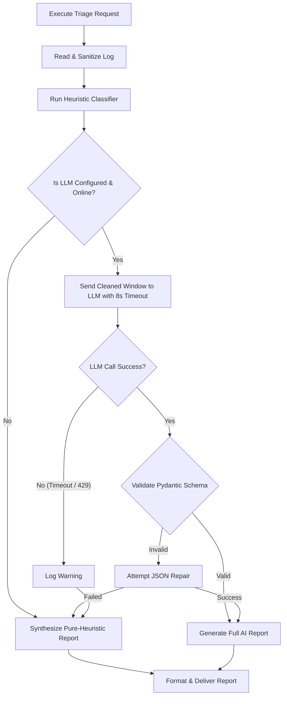

# Low-Level Design (LLD) & System Specifications
## AI-Powered CI/CD Build Failure Triage Assistant

**Version:** 1.0.0  
**Status:** Detailed Design Document  

---

## 1. Subsystem Decomposition & Package Structure

```
src/triage/
├── __init__.py                 # Package version & exports
├── config.py                   # Pydantic Settings & Env Config
├── models.py                   # Domain models & Pydantic schemas
├── engine.py                   # Core orchestrator pipeline
├── parser/
│   ├── __init__.py
│   ├── sanitizer.py            # ANSI stripper & normalizer
│   ├── redactor.py             # Secret/Token/Credential masking
│   ├── chunker.py              # Reverse-tail sliding window chunker
│   └── stacktrace_extractor.py # Regex extractors for Python/Java/Node/Go/Rust/Docker
├── classifier/
│   ├── __init__.py
│   ├── taxonomy.py             # Error category enumeration
│   └── heuristic_engine.py     # Deterministic regex matcher
├── llm/
│   ├── __init__.py
│   ├── client.py               # Unified LLM provider interface
│   └── prompts.py              # Prompt templates & JSON schemas
├── formatters/
│   ├── __init__.py
│   ├── markdown.py             # GitHub PR comment & Step Summary
│   ├── slack.py                # Slack Block Kit JSON builder
│   └── console.py              # Terminal Rich format
├── integrations/
│   ├── __init__.py
│   ├── github_client.py        # PyGithub API wrapper
│   ├── slack_client.py         # Slack incoming webhook dispatcher
│   └── webhook_server.py       # FastAPI webhook receiver
└── cli.py                      # Typer / Click CLI interface
```

---

## 2. Low-Level Component Design

### 2.1 Log Sanitizer & Redactor Design (`parser/sanitizer.py` & `parser/redactor.py`)

#### Regex Specifications:
1. **ANSI Code Stripping**:
   ```python
   ANSI_ESCAPE_RE = re.compile(r'\x1B(?:[@-Z\\-_]|\[[0-?]*[ -/]*[@-~])')
   ```
2. **Secret Redaction Pipeline**:
   ```python
   REDACTION_PATTERNS = [
       (re.compile(r'AKIA[0-9A-Z]{16}'), '[REDACTED_AWS_KEY]'),
       (re.compile(r'(?i)aws_secret_access_key\s*=\s*[A-Za-z0-9/+=]{40}'), '[REDACTED_AWS_SECRET]'),
       (re.compile(r'gh[pousr]_[A-Za-z0-9_]{36,255}'), '[REDACTED_GITHUB_TOKEN]'),
       (re.compile(r'sk-(?:proj-)?[a-zA-Z0-9_-]{32,64}'), '[REDACTED_API_KEY]'),
       (re.compile(r'Bearer\s+[A-Za-z0-9\-\._~\+\/]+=*'), 'Bearer [REDACTED_TOKEN]'),
       (re.compile(r'-----BEGIN (?:RSA|OPENSSH|PRIVATE) KEY-----[\s\S]*?-----END [^\n]+-----'), '[REDACTED_PRIVATE_KEY]'),
       (re.compile(r'(https?://[^:]+:)([^@]+)(@)'), r'\1[REDACTED_PASSWORD]\3')
   ]
   ```

### 2.2 Reverse-Tail Sliding Window Chunker (`parser/chunker.py`)

CI logs follow an inverted pyramidal signal density: the highest probability of containing error descriptions is near the bottom (EOF).

```python
def extract_high_signal_window(raw_log: str, max_lines: int = 200, context_before: int = 50) -> str:
    """
    Algorithm:
    1. Clean and split raw log into individual lines.
    2. Search backwards (from line N to 0) for primary error anchors:
       - 'FAILED' / 'FAILURES' / 'FAILURE:' / 'BUILD FAILED'
       - 'Traceback (most recent call last):'
       - 'npm ERR!' / 'yarn error'
       - 'panic:' / 'fatal error:' / 'panic: runtime error'
       - 'exit code 137' / 'JavaScript heap out of memory'
       - 'ERROR:' / 'FATAL:' / 'Exception in thread'
    3. If anchor is found at index i:
       start = max(0, i - context_before)
       end = min(len(lines), start + max_lines)
       return lines[start:end]
    4. If no anchor found:
       return lines[-max_lines:]
    """
```

### 2.3 Heuristic Rule Classification Matrix (`classifier/heuristic_engine.py`)

| Error Category | Regex Anchors | Default Suggested Action |
|---|---|---|
| `OUT_OF_MEMORY_OOM` | `exit code 137`, `OOMKilled`, `JavaScript heap out of memory`, `OutOfMemoryError` | Increase runner/container memory allocation (`--max-old-space-size`, `JAVA_OPTS=-Xmx2g`, runner specs). |
| `DEPENDENCY_CONFLICT` | `No module named '(\w+)'`, `npm ERR! ERESOLVE`, `Could not find a version that satisfies` | Run lockfile refresh or install missing module in `requirements.txt` / `package.json`. |
| `PERMISSION_SECRET_MISSING` | `401 Unauthorized`, `403 Forbidden`, `Permission denied`, `AccessDenied` | Verify environment secrets are mapped in GitHub Actions `secrets: ${{ secrets.XYZ }}`. |
| `INFRA_TIMEOUT` | `The operation was canceled after (\d+) minutes`, `ETIMEDOUT`, `Connection timed out` | Check network connectivity, slow test suites, or increase job timeout in workflow yaml. |
| `LINT_FORMAT_SECURITY` | `flake8:`, `ESLint:`, `Bandit:`, `Trivy:`, `black --check failed` | Run linter autofix locally (`black .`, `npm run lint:fix`) before committing. |

---

## 3. LLM Prompt Architecture & JSON Schema (`llm/prompts.py`)

### 3.1 System Prompt
```
You are an expert Principal Site Reliability and DevOps Engineer specializing in CI/CD build failure triage.
Your task is to analyze build failure logs, pinpoint the root cause, determine the error taxonomy, and produce actionable, syntax-accurate code fixes.

CRITICAL INSTRUCTIONS:
1. Provide a concise 1-2 sentence executive summary of the root cause.
2. Accurately identify the breaking file path and line number if visible.
3. Suggest the exact code diff using Unified Diff format.
4. Output strict JSON matching the schema without markdown wrappers.
```

### 3.2 Output JSON Schema
```json
{
  "type": "object",
  "properties": {
    "error_category": {
      "type": "string",
      "enum": [
        "SYNTAX_COMPILE_ERROR",
        "TEST_ASSERTION_FAILURE",
        "DEPENDENCY_CONFLICT",
        "OUT_OF_MEMORY_OOM",
        "INFRA_TIMEOUT",
        "PERMISSION_SECRET_MISSING",
        "LINT_FORMAT_SECURITY",
        "FLAKY_TRANSIENT_FAILURE",
        "UNKNOWN_FAILURE"
      ]
    },
    "confidence_score": { "type": "number", "minimum": 0.0, "maximum": 1.0 },
    "summary": { "type": "string" },
    "failed_step": { "type": "string" },
    "root_cause_file": { "type": ["string", "null"] },
    "root_cause_line": { "type": ["integer", "null"] },
    "suggested_fix": { "type": "string" },
    "code_diff": { "type": ["string", "null"] },
    "reproduction_command": { "type": ["string", "null"] }
  },
  "required": [
    "error_category",
    "confidence_score",
    "summary",
    "failed_step",
    "suggested_fix"
  ]
}
```

---

## 4. Output Formatting Design

### 4.1 GitHub PR Markdown Comment Layout (`formatters/markdown.py`)

```markdown
<!-- AI_CI_TRIAGE_ASSISTANT_BOT_COMMENT -->
## 🤖 CI/CD Build Failure Triage Assistant

> 🔴 **Category:** `TEST_ASSERTION_FAILURE` (Confidence: 96%)  
> 📌 **Failed Step:** `Run Pytest & Coverage Gate`  
> 📁 **Root Cause File:** `app/auth.py:42`

### 💡 Executive Summary
The authentication service failed with `TokenExpiredError` because test fixtures passed a hardcoded expired epoch timestamp instead of a dynamic UTC offset.

### 🛠️ Suggested Code Fix
```diff
- expiration = datetime.fromtimestamp(1600000000)
+ expiration = datetime.now(timezone.utc) + timedelta(hours=1)
```

### 🧪 Local Reproduction Command
```bash
pytest tests/test_auth.py -k test_jwt_generation -v
```

<details>
<summary>🔍 Extracted Stack Trace (Sanitized)</summary>

```text
tests/test_auth.py:42: in test_jwt_generation
    assert token_data["is_valid"] is True
E   AssertionError: assert False is True
```
</details>

---
*Generated by AI CI/CD Triage Assistant • [Documentation](https://github.com/example/ci-triage)*
```

### 4.2 Slack Block Kit Layout (`formatters/slack.py`)
- Header block with emoji category.
- Section with bold summary.
- Fields for `Repo/PR`, `Failed Step`, `Root Cause File:Line`.
- Markdown code block for diff.
- Action button linking directly to GitHub Action Run.

---

## 5. Error Handling, Retries & Fallbacks


