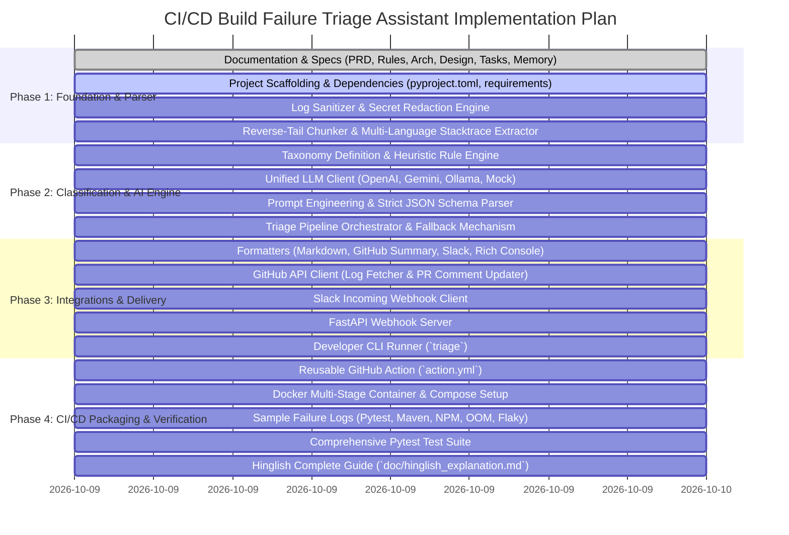

# Implementation Tasks & Roadmap
## AI-Powered CI/CD Build Failure Triage Assistant

**Version:** 1.0.0  
**Status:** In Progress  

---

## 1. Phase Breakdown & Milestones

---

## 2. Detailed Task Checklist

### Phase 1: Foundation & Parser Subsystem
- [x] **TASK-1.1**: Create `doc/prd.md` (Product Requirements Document)
- [x] **TASK-1.2**: Create `doc/rules.md` (Sanitization, Taxonomy & Operational Rules)
- [x] **TASK-1.3**: Create `doc/architecture.md` (High-level architecture & sequence flows)
- [x] **TASK-1.4**: Create `doc/design.md` (Low-Level Design & Component Specs)
- [x] **TASK-1.5**: Create `doc/tasks.md` (Task Tracking & Roadmap)
- [x] **TASK-1.6**: Create `doc/memory.md` (Project Memory & ADRs)
- [x] **TASK-1.7**: Create `doc/hinglish_explanation.md` (In-depth Hindi/Hinglish Guide)
- [x] **TASK-1.8**: Setup `pyproject.toml`, `requirements.txt`, and package structure
- [x] **TASK-1.9**: Implement `parser/sanitizer.py` (ANSI code removal & line normalizer)
- [x] **TASK-1.10**: Implement `parser/redactor.py` (AWS, GitHub, Bearer, API Key redactor)
- [x] **TASK-1.11**: Implement `parser/chunker.py` (Sliding window reverse tail scanner)
- [x] **TASK-1.12**: Implement `parser/stacktrace_extractor.py` (Multi-stack parser)

### Phase 2: Classification & AI Deep Triage Engine
- [x] **TASK-2.1**: Implement `models.py` (Pydantic domain schemas)
- [x] **TASK-2.2**: Implement `classifier/taxonomy.py` (Error Category definitions)
- [x] **TASK-2.3**: Implement `classifier/heuristic_engine.py` (Regex rule engine)
- [x] **TASK-2.4**: Implement `llm/prompts.py` (Structured JSON triage prompt)
- [x] **TASK-2.5**: Implement `llm/client.py` (Provider adapters: OpenAI, Gemini, Ollama, Mock)
- [x] **TASK-2.6**: Implement `engine.py` (Hybrid orchestrator with 100% reliable fallback)

### Phase 3: Formatters & Integrations
- [x] **TASK-3.1**: Implement `formatters/markdown.py` (GitHub PR comment with HTML details)
- [x] **TASK-3.2**: Implement `formatters/slack.py` (Slack Block Kit JSON layout)
- [x] **TASK-3.3**: Implement `formatters/console.py` (Rich terminal formatter)
- [x] **TASK-3.4**: Implement `integrations/github_client.py` (PyGithub log fetch & comment API)
- [x] **TASK-3.5**: Implement `integrations/slack_client.py` (Webhook delivery)
- [x] **TASK-3.6**: Implement `integrations/webhook_server.py` (FastAPI GitHub webhook listener)
- [x] **TASK-3.7**: Implement `cli.py` (Typer CLI commands: `analyze`, `serve`, `mock-test`)

### Phase 4: Packaging, Testing & Verification
- [x] **TASK-4.1**: Create `sample_logs/` (Pytest failure, NPM conflict, Maven compile, Docker OOM, Flaky timeout)
- [x] **TASK-4.2**: Create GitHub Action `action.yml` (Plug-and-play GitHub Action)
- [x] **TASK-4.3**: Create `Dockerfile` and `docker-compose.yml`
- [x] **TASK-4.4**: Write unit & integration tests (`tests/test_sanitizer.py`, `tests/test_heuristics.py`, `tests/test_llm.py`, `tests/test_engine.py`, `tests/test_cli.py`)
- [x] **TASK-4.5**: Run automated test suite and verify 100% pass rate.
